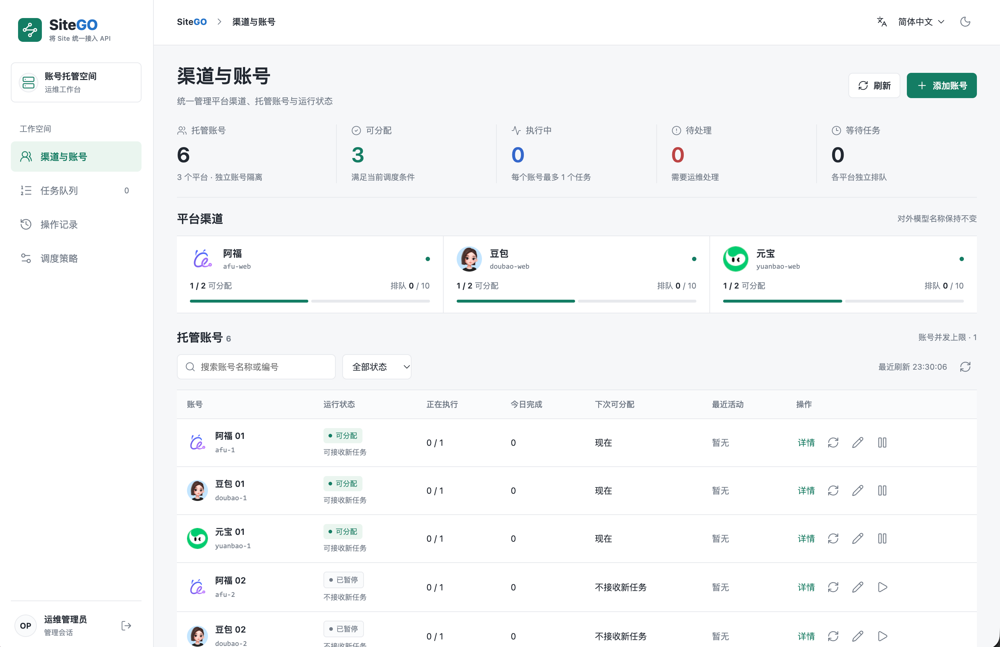
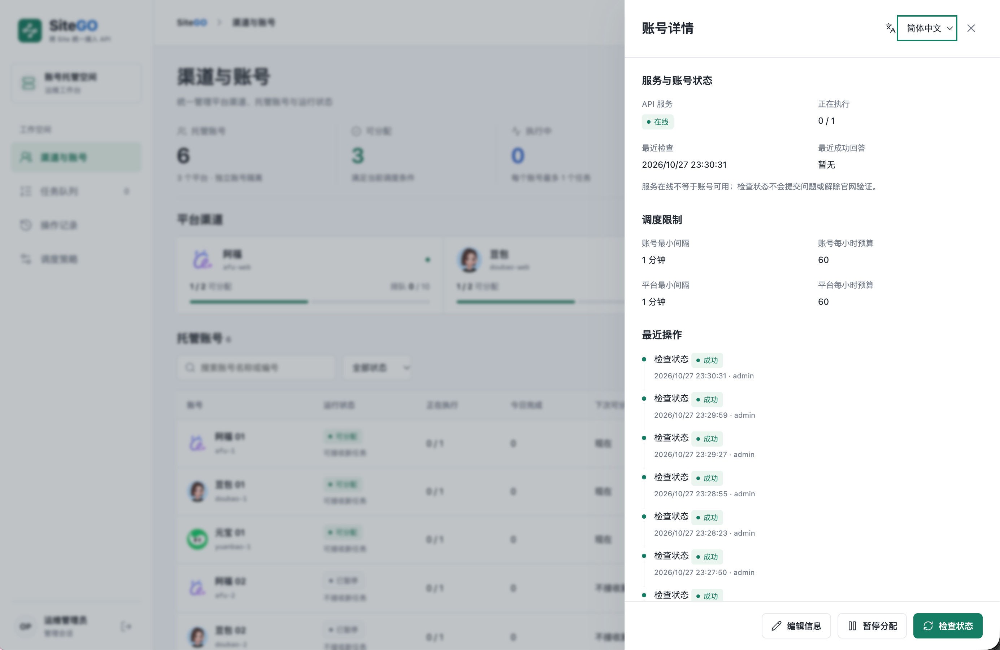
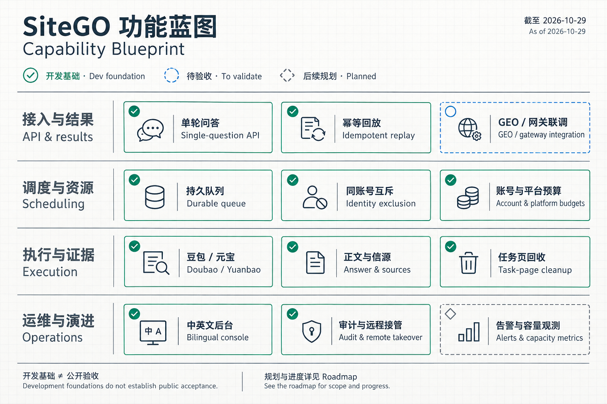
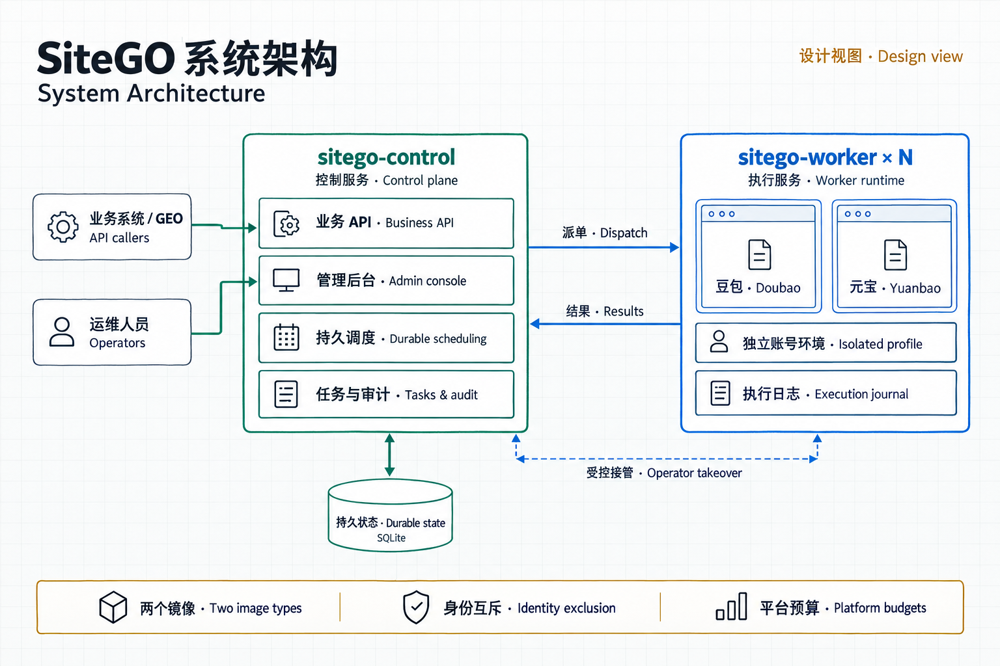
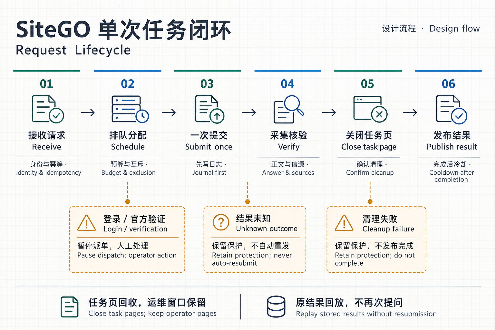

  <picture>
    <source media="(prefers-color-scheme: dark)" srcset="assets/brand/sitego-dark.svg">
    
  </picture>

<h3 align="center">将网站问答，统一接入 API。</h3>

  旨在连接豆包与元宝，服务 GEO 检测与业务集成。 
  账号有序调度，回答有据可查，任务进度清晰可见。

  
  
  
  

<b>简体中文</b> · <a href="README.md">English</a>

  <a href="#产品预览">产品预览</a> · <a href="#核心能力">核心能力</a> · <a href="#功能蓝图">功能蓝图</a> · <a href="#功能进度">功能进度</a> · <a href="#系统架构">系统架构</a> ·
  <a href="ROADMAP.zh-CN.md">路线图</a> · <a href="releases/README.zh-CN.md">发布规范</a> · <a href="#许可与商业使用">使用许可</a>

---

SiteGO 面向 **GEO（Generative Engine Optimization，生成式引擎优化）检测、信源采集与业务系统集成**，将网站问答接入统一 API 和运维后台：提交独立问题，查看执行过程，获取回答及其来源。

> **文档预览 · 应用公开版准备中** · 更新于 2026-10-29
>
> 当前仓库仅包含产品文档、截图、架构图、路线图、许可草案、发布规范及品牌素材。应用源码、安装包和公开镜像尚未发布。首批应用公开范围为豆包与元宝；阿福 worker 保持私有，等待项目所有者另行明确同意。

## 产品预览

### 渠道与托管账号

集中查看平台可用性、账号状态、排队数量和运维入口。

  

### 账号检查与调度限制

先查看服务状态、请求预算和最近操作，再决定是否让账号重新参与调度。

  

以上是项目所有者提供的完整开发版截图，包含阿福界面，不代表公开版可用范围或平台验收结论。阿福 worker 暂不公开。截图额度为示例配置，不是官网认可的安全频率；点击图片可查看原图。

## 核心能力

| 能力 | 解决的问题 |
| --- | --- |
| **一次问题，一个任务** | 独立处理请求，完成后回收任务页面，同时保留运维页面。 |
| **有序的账号调度** | 持久队列、账号与平台两级预算，同一逻辑账号互斥执行。 |
| **带信源的回答** | 分别记录正文、候选来源、直接引用与原文摘录，明确展示缺失或不完整的证据。 |
| **防止盲目重复提问** | 持久保存幂等与执行记录，已提交但结果未知的问题不自动重发。 |
| **统一运维工作台** | 管理账号、任务、策略和审计，支持中英文及亮暗主题。 |
| **及时的人工接管** | 通过鉴权远程桌面处理登录或官方验证，接管期间阻止任务提交。 |

以上描述开发能力与计划公开范围，公开版验收情况见下方[功能进度](#功能进度)。

## 功能蓝图

按接入、调度、执行和运维四层组织能力。实线表示已有开发基础，虚线分别标明待验收或后续规划；图中状态不代表公开交付。

  

GEO 与网关的真实联调、运维告警和容量观测属于后续工作，详见[路线图](ROADMAP.zh-CN.md)。

## 平台范围

| 平台 | 公开版计划 | 当前边界 |
| --- | --- | --- |
|  **Doubao / 豆包** | 首个发布候选 | 已有本机单题证据，完整公开版验收待完成。 |
|  **Yuanbao / 元宝** | 首个发布候选 | 已有本机单题证据，支持模式须逐项验证。 |

项目所有者另行明确同意前，阿福 worker 不进入公开源码、包、镜像层或 Git 历史，也不以禁用功能的形式包含在公开产物中。

请求预算是运维保护措施，不是保证可用的安全频率。SiteGO 不承诺绕过平台验证，也不保证第三方网站始终可用。

## 功能进度

**开发进度与公开交付分开记录。** 以下为截至 2026-10-29 的已记录状态。

| 范围 | 开发证据 | 公开版验收 |
| --- | --- | --- |
| 豆包与元宝 | 本机单题 API 结果及持久回放。 | 公开导出、支持模式覆盖及完整验收待完成。 |
| 调度与生命周期 | 队列、账号互斥、幂等和任务页回收已有自动化覆盖。 | 持续负载与故障恢复验收待完成。 |
| 运维后台 | 账号、任务、策略、审计、中英文界面及运维操作。 | 公开配置及端到端验收待完成。 |
| 远程桌面与镜像 | 本机合成浏览器检查与 ARM64 Linux 运行证据。 | 目标架构构建、打包及安装验收待完成。 |
| GEO 与 API 网关 | 兼容要求与本地契约。 | 真实集成及信源入库验收待完成。 |

[公开版路线图](ROADMAP.zh-CN.md)持续记录里程碑、发布门槛和剩余工作，不因私有版已有实现就将公开版标记为已发布。

## 系统架构

一个项目、两种镜像：管理后台与控制服务共同交付，执行服务按托管账号部署。以下是设计视图，不是当前线上部署拓扑。

  

| 层次 | 职责与边界 |
| --- | --- |
| 接入 | 业务系统通过 API 提交问题；运维人员通过管理后台查看和处理账号。 |
| `sitego-control` | 业务及管理 API、持久调度、任务和审计；后台包含在此镜像内。 |
| 持久状态 | 保存队列、任务、幂等和审计记录；SQLite 不是对外暴露的第三个服务。 |
| `sitego-worker` | 按逻辑账号隔离浏览器环境，执行平台适配并保留执行日志；多个实例仍属于一种镜像。 |
| 人工接管 | 管理端鉴权后开启受控远程桌面，接管期间阻止派单和提交。 |

同一逻辑账号共享互斥与预算，增加容器不会自动增加平台额度。GitHub 版独立维护公开历史与发布材料，Codeup 开发流程保持独立。

### 单次任务如何闭环

  

1. 接收独立问题，先核对身份与幂等；可回放的原结果不再重新提问。
2. 持久排队，检查账号互斥、平台预算和冷却，再分配 worker。
3. 先记录发送边界，再发起本次提问；已提交且结果未知时不自动重发。
4. 采集并核对正文与信源，暂存已验证结果。
5. 确认关闭本任务页面，保留运维窗口；清理失败保持保护。
6. 发布完成结果并开始冷却。登录或官方验证由人工处理，不自动解除未知任务保护。

## 近期 Roadmap

以 **2026-10-29** 为基线。勾选项说明已记录的开发或文档成果，不等同于公开版验收通过。

- [x] Control / Worker 架构与独立发布材料。
- [x] 豆包、元宝本机单题 API 及结果回放基础。
- [x] 持久调度、同账号互斥与任务页回收的本机验证。
- [x] 中英文后台、受控远程桌面及双语产品说明。
- [ ] **11 月上半月**：整理不含阿福的公开候选，定稿许可与支持范围。
- [ ] **11 月下半月**：完成公开候选的故障、固定负载与资源验收。
- [ ] **11 月末至 12 月中旬**：完成 GEO／网关联调、目标环境安装及回退演练。
- [ ] **12 月中下旬**：全部约定验收通过后，准备首次源码与镜像公开。

日期为规划窗口，会随验收结果调整。[完整路线图](ROADMAP.zh-CN.md)包含逐项清单、完成条件和后续演进方向。

## 获取与安装

首个通过验收的公开版本会提供安装说明、配置示例、支持的镜像摘要及可复现的验收范围。**目前尚无可安装的公开应用包或镜像。**

现阶段可以先通过产品截图、进度表和路线图判断 SiteGO 是否适合你的使用场景。

后续已验收版本采用附注 **Tag + GitHub Release** 发布，附中英文说明，覆盖改动、升级方式、已知限制与已验证产物。详见[发布规范与模板](releases/README.zh-CN.md)。本次文档预览不属于应用版本发布。

## 许可与商业使用

> **任何商业使用，均须事先取得著作权人的书面授权。**

计划采用 **源码可见、限非商业用途** 的模式，不将其标为 MIT、Apache-2.0 或符合 OSI 定义的开源许可。[中文许可草案](LICENSE-DRAFT.zh-CN.md)与[英文草案](LICENSE-DRAFT.md)记录拟定条款，目前不构成生效的软件使用许可。

公开源码前仍须确定权利主体、授权联系方式、最终条款与第三方声明。第三方组件和平台品牌保留各自权利，视觉素材说明见[素材记录](assets/README.zh-CN.md)。

## 持续维护与反馈

项目由 **琅琊（`langya-ascend`）** 持续维护。有效反馈应包含公开版本号、平台、复现步骤及脱敏日志，不要提供密码、Cookie、账号资料或私有问题内容。

如果项目对你有帮助，欢迎 Star 和提供可复现的问题，让更多人发现并改进 SiteGO。贡献流程会随首个经过验证的源码版本提供。

---

  <b>SiteGO</b> · 让网站能力进入你的工作流。 
  <a href="README.md">English</a> · <a href="ROADMAP.zh-CN.md">路线图</a> · <a href="LICENSE-DRAFT.zh-CN.md">许可草案</a>

